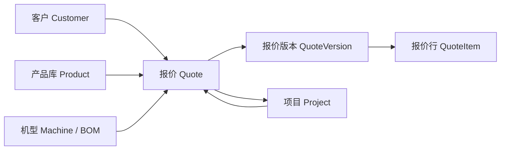
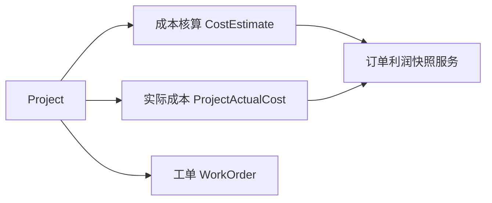
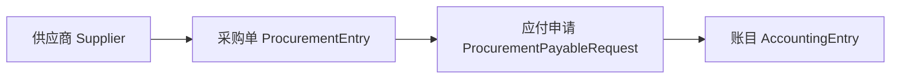
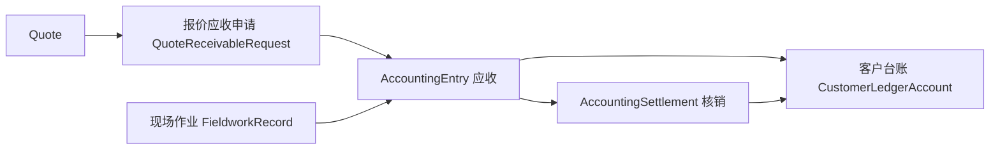
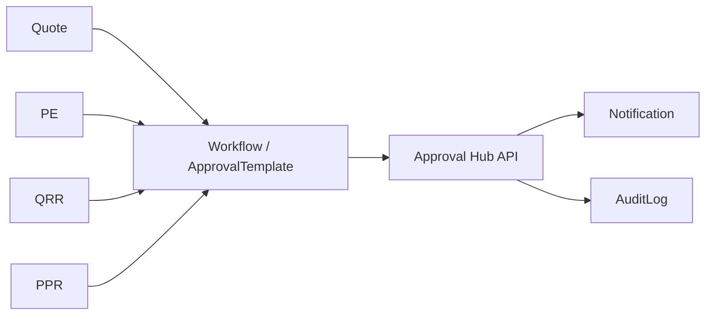

# 核心业务流程与数据流向

> 基于代码与模型梳理（2026-10-23）。箭头表示主数据流；财务 Posting 以 accounting_entries 为中心。

---

## 1. 销售与报价

**要点（📄 模型）**：

- 报价必填 `customer_id`；可选 `project_id`、`product_id`、`machine_id`、`bom_id`、成本/售价模板。  
- 项目可设 `primary_quote_id` 指向主报价。  
- 审批流：`workflow_state`、quote_approvals / 模板表；导出：quote_export_tasks + Worker。

**员工路径（目标态）**：选客户 →（可选选项目）→ 选产品/机型 → 自动带出价格模板 → 填数量 → 服务端算价 → 保存/提交审批。

**现状风险**：产品与机型双入口（见 `UX_AND_BUSINESS_SIMPLIFICATION.md` UX-001）。

---

## 2. 项目执行与成本

- 成本核算支持物料/工艺/机型行（`CostEstimate*` lines）。  
- 实际成本手工录入面板：`project-actual-costs-panel.tsx`。

---

## 3. 采购与应付

**原则**：采购单、应付、付款/核销为不同对象；金额不得简单合并重复计算（任务书 §6.4）。

---

## 4. 应收、收款与核销

- 现场维修费用：`fieldwork_repair_billing` 迁移与 `fieldwork_receivable_service` 📄。  
- 业务开关：`quote_receivable_enabled`、`accounting_enabled`（`business_settings`）。

---

## 5. 审批与通知

移动审批端消费同一 `/approvals` 与 quote/workflow 状态（待运行验证）。

---

## 6. 产品与制造数据（并行域）

- **产品库**：分类树、成本/售价模板、标准产品报价来源。  
- **机型/BOM**：历史工业路径，选项组 option_groups、设备序列号 equipment_units、验收/安装计划（侧栏已隐藏，路由保留）。  
- **MES**：`/mes/equipment-signals`、OEE 快照 — 与 ERP 核心 loosely coupled。

---

## 7. 权限与数据范围

- JWT access/refresh 分离；realtime 短票证 📄 `security.py`。  
- 角色数据范围：迁移 `0004_role_data_scope` + 大量 `test_data_scope_*` / repository predicate 测试。  
- **服务端** `require_permissions` 为权威；前端菜单仅隐藏入口。

---

## 8. 待验证断点（第二批）

| 断点 | 说明 |
|---|---|
| 报价前端算价 vs 后端 | 必须以服务端为准做验收用例 |
| 采购→应付 Web 是否一步可见 | 需手工走单 |
| 财务核销 UI 与并发 | 需 integration_tests + 手工 |
| 演示数据 DEMO-Q-001 | `docs/DEMO_QUOTE.md` 流程 |
